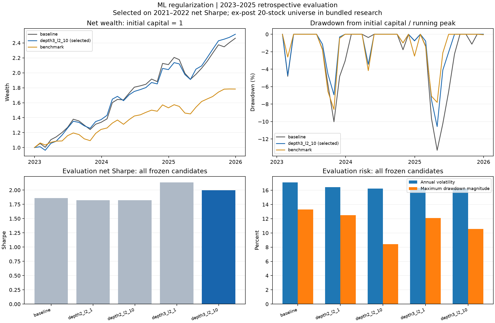

# Frozen ML regularization study

Selected candidate: **depth3_l2_10**, using only 2021–2022 net Sharpe.

## Baseline versus selected candidate

| Segment | Candidate | CAGR | Annual alpha | Sharpe | Annual volatility | Max drawdown |
|---|---|---:|---:|---:|---:|---:|
| Validation 2021–2022 | baseline | 13.32% | 11.97% | 0.691 | 21.38% | -19.86% |
| Validation 2021–2022 | depth3_l2_10 | 17.36% | 15.45% | 0.853 | 21.44% | -19.67% |
| Evaluation 2023–2025 | baseline | 35.04% | 9.71% | 1.861 | 17.09% | -13.29% |
| Evaluation 2023–2025 | depth3_l2_10 | 36.01% | 11.23% | 1.996 | 16.22% | -10.57% |

## All evaluation candidates (no reselection)

| Candidate | Selected | Annual alpha | Sharpe | Annual volatility | Max drawdown |
|---|---|---:|---:|---:|---:|
| baseline |  | 9.71% | 1.861 | 17.09% | -13.29% |
| depth2_l2_1 |  | 8.05% | 1.824 | 16.45% | -12.50% |
| depth2_l2_10 |  | 8.90% | 1.824 | 16.25% | -8.43% |
| depth3_l2_1 |  | 12.90% | 2.133 | 16.34% | -12.11% |
| depth3_l2_10 | yes | 11.23% | 1.996 | 16.22% | -10.57% |

## Evaluation changes versus baseline

- Net Sharpe change: +0.136.
- Annual alpha change: +1.52 percentage points.
- Annual volatility change: -0.87 percentage points.
- Maximum drawdown change: +2.72 percentage points (positive means less severe).

## Interpretation and reproducibility

The 2023–2025 results were already inspected in prior research. This is a retrospective chronological evaluation, not an unseen holdout. No test-period winner is substituted for the validation-selected candidate.

Monthly expanding refits use only labels ending strictly before prediction. Hyperparameters are fixed for evaluation. Each segment restarts in cash; the initial deployment cost is included. These segment results must not be compared directly to the official continuous 2018–2025 table.

Annual alpha is the existing annualized single-benchmark intercept at zero risk-free rate, not excess CAGR or factor-adjusted alpha. The ex-post survivor universe, missing delistings, stock-adjusted versus price-index benchmark mismatch and same-close execution remain limitations.

See `protocol.md`, `config.json`, `selection.json` and `manifest.json`. CSV summaries, net returns, scores and target/return ledgers retain all candidates, including worse results. No official v1.0 reports are overwritten.
